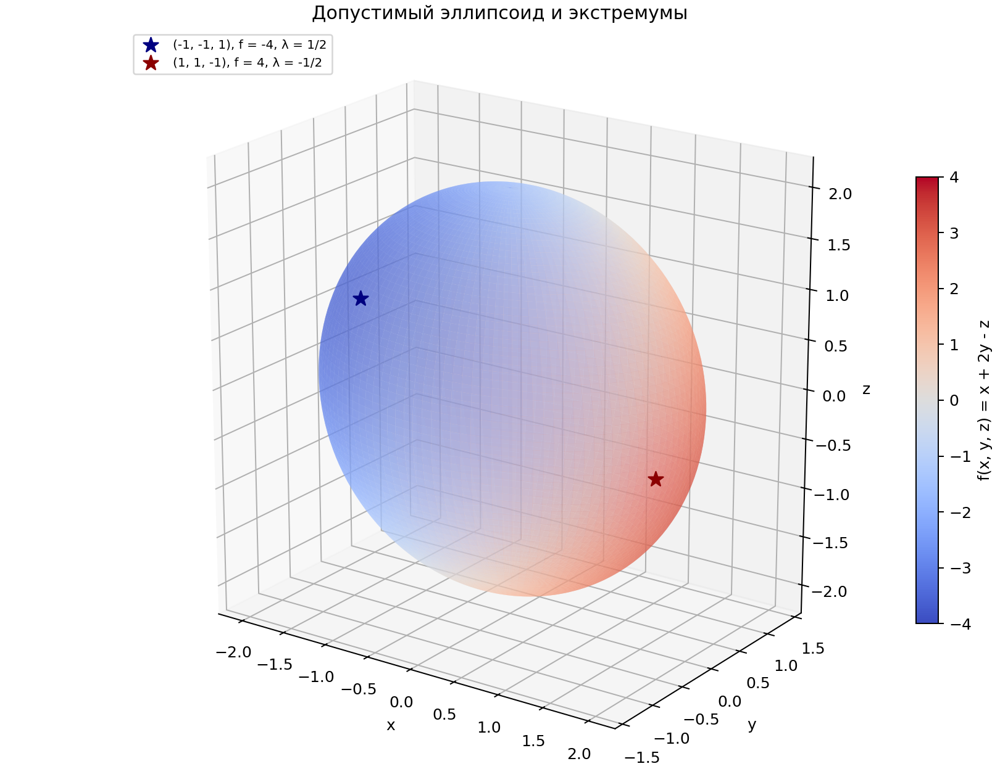
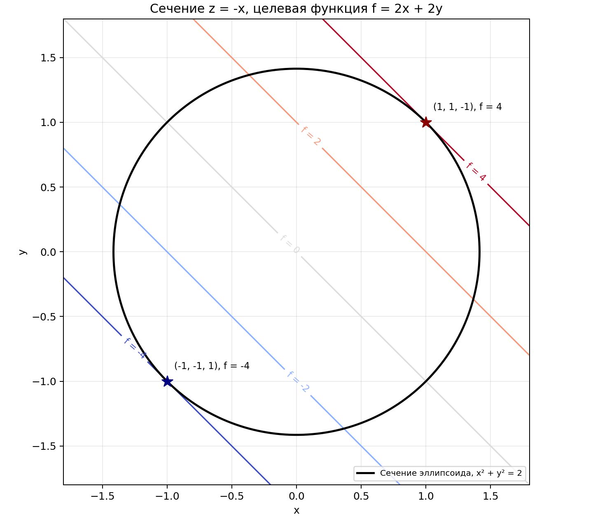

# Дополнительное задание к лабораторной работе № 3

**Тема:** Решение задач многомерной условной оптимизации методом множителей Лагранжа
**Вариант:** 14

## 1. Задача и геометрическая интерпретация

В [основном отчете](Отчет%20МетОпт%20лр3.pdf) требуется найти минимум и максимум

$$f(x,y,z)=x+2y-z$$

при условии

$$h(x,y,z)=x^2+2y^2+z^2-4=0.$$

Допустимое множество является поверхностью эллипсоида с полуосями 2, $\sqrt2$ и 2. Поверхности уровня целевой функции имеют вид

$$x+2y-z=c.$$

Это параллельные плоскости с нормалью $\nabla f=(1,2,-1)$. Изменяя $c$, мы перемещаем плоскость. Крайние значения достигаются в местах касания плоскости уровня и эллипсоида. В регулярной точке касания их нормали параллельны.

Условие Лагранжа записывается

$$\nabla f+\lambda\nabla h=0.$$

Оно означает, что на поверхности нет касательного направления с ненулевым первым изменением целевой функции. Для вывода о глобальности отдельно учитываются компактность множества и полнота найденных кандидатов.

## 2. Проверка решения

Функция Лагранжа

$$\mathcal L=x+2y-z+\lambda(x^2+2y^2+z^2-4).$$

Система стационарности

$$
\begin{cases}
1+2\lambda x=0,\\
2+4\lambda y=0,\\
-1+2\lambda z=0,\\
x^2+2y^2+z^2=4.
\end{cases}
$$

Значение $\lambda=0$ невозможно по первому уравнению. Поэтому

$$x=y=-\frac{1}{2\lambda},\qquad z=\frac{1}{2\lambda}.$$

Подставляя в ограничение, получаем $1/\lambda^2=4$, откуда $\lambda=\pm1/2$.

| Точка       | Множитель | Значение $f$ | Градиент ограничения | Результат           |
| ----------- | --------- | ------------ | -------------------- | ------------------- |
| $(-1,-1,1)$ | $1/2$     | -4           | $(-2,-4,2)$          | Глобальный минимум  |
| $(1,1,-1)$  | $-1/2$    | 4            | $(2,4,-2)$           | Глобальный максимум |

В первой точке $\nabla f=-\frac12\nabla h$, во второй $\nabla f=\frac12\nabla h$. Нормали коллинеарны. Обе точки удовлетворяют ограничению.

Глобальные границы можно проверить непосредственно по неравенству Коши-Буняковского

$$|x+2y-z|=|(x,\sqrt2y,z)\cdot(1,\sqrt2,-1)|$$
$$\le\sqrt{x^2+2y^2+z^2}\sqrt{1+2+1}=2\cdot2=4.$$

В найденных точках достигаются оба равенства. Значит, минимум равен -4, максимум 4.

## 3. Эллипсоид и значения функции



Поверхность задает допустимое множество. Цвет соответствует значению $f$ на ней, шкала справа меняется от -4 до 4. Синяя звезда показывает минимум, красная максимум. В легенде указаны координаты, значения функции и множители Лагранжа.

Для построения использована параметризация

$$x=2\sin\theta\cos\varphi,\qquad y=\sqrt2\sin\theta\sin\varphi,\qquad z=2\cos\theta.$$

Здесь $0\le\theta\le\pi$, $0\le\varphi\le2\pi$. Подстановка дает

$$x^2+2y^2+z^2=4\sin^2\theta(\cos^2\varphi+\sin^2\varphi)+4\cos^2\theta=4.$$

Таким образом, все изображенные узлы поверхности допустимы.

## 4. Сечение и касание линий уровня

Обе точки экстремума лежат в плоскости $z=-x$. Возьмем сечение эллипсоида этой плоскостью. Тогда

$$x^2+2y^2+x^2=4\quad\Longrightarrow\quad x^2+y^2=2.$$

В координатах $x,y$ получается окружность радиуса $\sqrt2$, а целевая функция в сечении равна

$$f(x,y,-x)=2x+2y.$$

Линии уровня имеют вид $2x+2y=c$.



Черная окружность обозначает допустимые точки сечения. Цветные прямые соответствуют уровням -4, -2, 0, 2 и 4. Промежуточные уровни пересекают окружность. Уровень 4 касается ее в $(1,1)$, уровень -4 касается в $(-1,-1)$. После восстановления $z=-x$ получаются трехмерные точки из таблицы.

На уровне 4 прямая имеет вид $x+y=2$. Подставим $y=2-x$ в окружность

$$x^2+(2-x)^2=2\quad\Longrightarrow\quad2(x-1)^2=0.$$

Есть единственная точка пересечения $x=y=1$, то есть касание. Аналогично для уровня -4 получается $2(x+1)^2=0$. Уровни с $|c|>4$ сечение не пересекают.

Рисунок показывает именно сечение, а не проекцию всего эллипсоида на плоскость $xy$. Глобальность результатов в трехмерной задаче подтверждена отдельным неравенством из раздела 2.

## 5. Работа кода и запуск

Дополнительная программа [lab3_extra.py](lab3_extra.py) импортирует функцию, ограничение и переменные из основного файла. В `find_candidates` заново строятся функция Лагранжа и система, решения находятся через SymPy и проверяются подстановкой в ограничение. Координаты экстремумов не заданы готовым ответом.

`draw_ellipsoid` строит поверхность по параметризации и окрашивает ее по значениям цели. `draw_section` подставляет $z=-x$, изображает окружность и линии уровня. Геометрия рисунков рассчитана на вариант 14.

Запуск из папки `lab3`

```bash
python lab3_extra.py
```

Необходимы SymPy, NumPy и Matplotlib. При необходимости установка выполняется командой `python -m pip install sympy numpy matplotlib`.

Программа выводит две точки и сохраняет `img/lagrange_ellipsoid.png` и `img/lagrange_section.png`. Получены минимум -4 в $(-1,-1,1)$ и максимум 4 в $(1,1,-1)$, что совпадает с основным отчетом.
