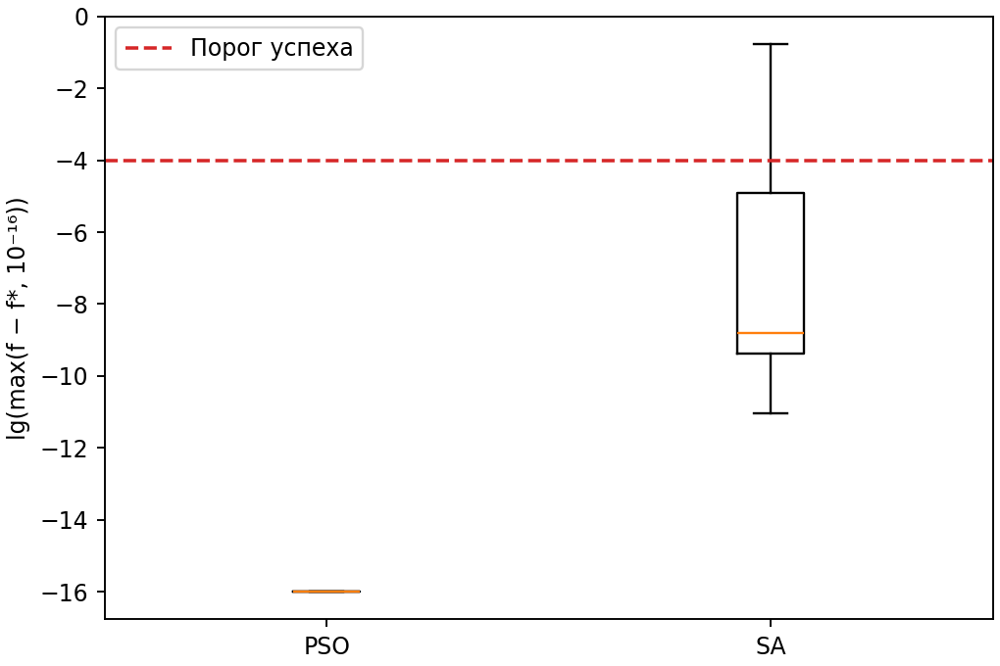
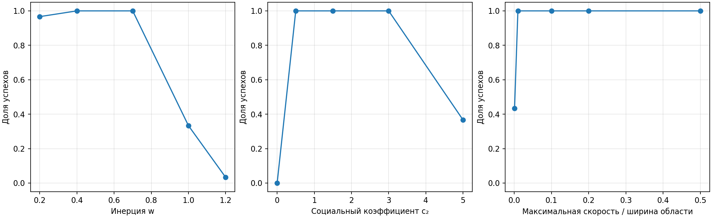

# Самостоятельная работа к лабораторной работе № 5

**Дисциплина** - Методы оптимизации  
**Выполнила** - Левчук Софья Александровна, группа К3341  
**Вариант** - 14, рой частиц PSO с критерием Метрополиса из имитации отжига SA  
**Тестовая функция** - Шаффера N.2

## 1. Проверка примеров из указаний

В этом разделе повторены вычисления примеров 1 всех разделов. Для островной модели рассмотрен единственный пример распределения бюджета. Выборочные характеристики случайных шагов проверены отдельным воспроизводимым расчетом. Промежуточные вычисления выполнялись без округления.

### 1.1. Генетический алгоритм

Минимизируем $f(x)=(x-11)^2$ на целых числах от 0 до 15. Декодирование четырех битов дает $0101_2=5$, $1100_2=12$, $0011_2=3$, $1001_2=9$.

Получаем $f(5)=36$, $f(12)=1$, $f(3)=64$, $f(9)=4$. Для рулетки вычислим приспособленности $\varphi_i=1/(1+f_i)$ и их сумму

$$S=\frac1{37}+\frac12+\frac1{65}+\frac15\approx0.74241164.$$

Вероятности равны $p_i=\varphi_i/S$.

| Код | $f$ | $\varphi$ | Вероятность рулетки | Ранг | Ранговая вероятность |
|---|---|---|---|---|---|
| 0101 | 36 | 0.02702703 | 0.03640437 | 2 | 0.2 |
| 1100 | 1 | 0.5 | 0.67348082 | 4 | 0.4 |
| 0011 | 64 | 0.01538462 | 0.02072249 | 1 | 0.1 |
| 1001 | 4 | 0.2 | 0.26939233 | 3 | 0.3 |

Сумма рангов равна 10. Поэтому ранговые вероятности получены делением ранга на 10. В турнире особей 1 и 3 побеждает особь 1, поскольку $36<64$. В турнире особей 2 и 4 побеждает особь 2, поскольку $1<4$.

Для родителей $11|00$ и $10|01$ обмен хвостами дает $1101_2=13$, $1000_2=8$. Значения функции равны 4 и 9. При маске 1010 берем первый и третий биты первого родителя, второй и четвертый второго. Получаем 1001. Инверсия третьего слева бита дает $1011_2=11$ и $f=0$.

Для вещественных родителей $a=(1,2)$, $b=(3,1)$ арифметическое скрещивание дает $0.25a+0.75b=(2.5,1.25)$. В BLX-0.3 расстояния между координатами родителей равны 2 и 1. Расширенные интервалы равны $[1-0.6,3+0.6]=[0.4,3.6]$ и $[1-0.3,2+0.3]=[0.7,2.3]$. Результаты совпадают с указаниями.

### 1.2. Имитация отжига

При ухудшении на $\Delta f>0$ вероятность принятия равна $P=\exp(-\Delta f/T)$. Например, при $\Delta f=1$, $T=10$ получаем $e^{-0.1}=0.904837$.

| $\Delta f$ | $T=10$ | $T=1$ | $T=0.1$ |
|---|---|---|---|
| 1 | 0.904837 | 0.367879 | $4.539993\cdot10^{-5}$ |
| 5 | 0.606531 | 0.00673795 | $1.928750\cdot10^{-22}$ |

При геометрическом охлаждении $T_k=10\cdot0.95^k$ получаем $T_{10}=5.987369$, $T_{50}=0.769450$. По формуле $T_k=10/\ln(1+k)$ получаем $T_{10}=4.170324$, $T_{1000}=1.447439$. Значения совпадают с округленными числами методички. Последняя формула применяется при $k\ge1$, поскольку при $k=0$ знаменатель обращается в ноль.

### 1.3. Поиск с запретами

Из таблицы значений функции в указаниях обычный спуск выполняет $0\to1$, поскольку $5>3$. Затем оба соседа точки 1 хуже, поэтому спуск заканчивается.

Пусть запрещено возвращаться в три последние покинутые точки. Из 1 возврат в 0 запрещен, поэтому выбирается 2 со значением 4. Из 2 возврат в 1 запрещен, поэтому выбирается 3 со значением 6. Далее аналогично получаем

$$0\to1\to2\to3\to4\to5\to6\to7\to8\to9\to10.$$

Значения вдоль пути равны $5,3,4,6,2,1,3,7,4,0,6$. Лучший результат сохраняется отдельно от текущего положения. После посещения 10 рекорд остается $x=9$, $f=0$. Если из 10 все допустимые соседи запрещены, требуется правило завершения или снятия запрета. Для приведенного конечного прохода достаточно завершения.

### 1.4. Муравьиный алгоритм

При $\alpha=1$, $\beta=2$ вес города равен $w=\tau/d^2$. Получаем $w_B=1/2^2=0.25$, $w_C=2/4^2=0.125$, $w_D=1/5^2=0.04$. Сумма весов равна 0.415.

$$p_B=0.25/0.415=0.602410,\quad p_C=0.125/0.415=0.301205,\quad p_D=0.04/0.415=0.096386.$$

После испарения и добавления феромона $\tau_{AB}=(1-0.5)\cdot1+10/12=1.333333$.

В ACO_R при $k=30$, $q=0.1$ общий множитель весов сокращается. Поэтому

$$p_l=\frac{\exp(-(l-1)^2/18)}{\sum_{j=1}^{30}\exp(-(j-1)^2/18)}.$$

Для рангов 1, 2, 3, 5, 10 получаем 0.234745, 0.222059, 0.187969, 0.096507, 0.002608. Вероятность выбрать одно из пяти лучших решений равна 0.883660. Это согласуется с округлением до 88 % в указаниях.

### 1.5. Искусственная пчелиная колония ABC

Изменяется первая координата источника $x_i=(1,2)$ при $x_k=(3,-1)$ и $\varphi=-0.5$.

$$v_1=1+(-0.5)(1-3)=2,\qquad v_2=2.$$

Новый источник равен $(2,2)$. Для неотрицательного $f$ используем $fit=1/(1+f)$, для отрицательного $fit=1+|f|$. Получаем $2/3$, $1/3$, $1/11$, $2$. Сумма равна $34/11$.

Вероятности наблюдателей равны $11/51=0.215686$, $11/102=0.107843$, $1/34=0.029412$, $11/17=0.647059$. Округленные значения совпадают с таблицей указаний.

### 1.6. Пчелиный алгоритм Bees

Два элитных участка получают по 10 проб, три остальных выбранных участка по 4 пробы. Еще $20-5=15$ пчел исследуют область.

$$NFE_{iter}=2\cdot10+3\cdot4+15=47.$$

Если учитывать 20 начальных вычислений, число полных итераций равно $\lfloor(10000-20)/47\rfloor=212$. Затраты равны $20+212\cdot47=9984$, остаток бюджета составляет 16 вычислений. Число итераций из указаний подтверждено при явном учете инициализации.

### 1.7. Рой частиц PSO

Даны $x=(2,1)$, $v=(0.5,-0.5)$, $p=(1.5,1)$, $g=(0,0)$, $w=0.7$, $c_1=c_2=1.5$, $r_1=(0.4,0.8)$, $r_2=(0.6,0.2)$.

Инерционная часть равна $wv=(0.35,-0.35)$. Личная память дает $1.5(0.4,0.8)\odot(-0.5,0)=(-0.3,0)$. Притяжение к лидеру дает $1.5(0.6,0.2)\odot(-2,-1)=(-1.8,-0.3)$.

$$v_{new}=(-1.75,-0.65),\qquad x_{new}=(2,1)+v_{new}=(0.25,0.35).$$

В этом примере предполагается, что ограничение скорости и границы не изменяют полученные значения. Ответ совпадает с методичкой.

### 1.8. Дифференциальная эволюция DE

При $F=0.5$ мутант равен

$$v=(1,1)+0.5((3,0)-(2,2))=(1.5,0).$$

Исходная особь $x_i=(0,0.5)$, $CR=0.9$. Если $r=(0.3,0.95)$ и обязательная координата $j_{rand}=2$, первая координата берется из мутанта по условию $0.3<0.9$, вторая по обязательному индексу. Получаем $u=(1.5,0)$.

При $r=(0.95,0.95)$ и $j_{rand}=1$ меняется только первая координата, поэтому $u=(1.5,0.5)$. Для решения о замене исходной особи требуется сравнить значения целевой функции. В примере функция не задана, поэтому вычислен только кандидат.

### 1.9. Поиск кукушки и шаги Леви

Для $\beta=1.5$ подстановка в формулу Мантеньи дает

$$\sigma_u=\left(\frac{\Gamma(2.5)\sin(3\pi/4)}{\Gamma(1.25)\cdot1.5\cdot2^{0.25}}\right)^{2/3}\approx0.69657450.$$

В частности, при $u=\sigma_u$ и $v=1$ шаг $L=u/|v|^{2/3}$ равен 0.69657450. При $v=0.01$ знаменатель равен примерно 0.046416, поэтому $L\approx15.007$. Малый знаменатель способен породить длинный шаг.

Для проверки выборочной части использован `numpy.random.default_rng(14)`. Последовательно сгенерированы три массива по 100000 стандартных нормальных значений. Первые два использованы в $L=\sigma_u Z_1/|Z_2|^{2/3}$, третий для гауссова сравнения.

| Распределение | Доля $|L|>3$ | 99-й перцентиль модуля |
|---|---|---|
| Шаг Мантеньи, $\beta=1.5$ | 0.07556 | 11.4173 |
| Стандартное нормальное | 0.00284 | 2.5782 |

Выборочные значения зависят от зерна. В этой проверке большие шаги встречаются примерно в $0.07556/0.00284\approx26.6$ раза чаще. Результат согласуется с тенденцией примера, где приведено около 30 раз. Теоретически для стандартного нормального распределения $P(|Z|>3)\approx0.0026998$.

### 1.10. Островная модель

Три острова по 30 особей требуют $3\cdot30=90$ вычислений на инициализацию. При оценивании 30 новых особей каждого острова общий цикл также требует 90 вычислений.

$$K=\left\lfloor\frac{10000-90}{90}\right\rfloor=110.$$

С учетом инициализации получается 110 полных циклов и остаток 10 вычислений. Число 111 из указаний получается делением полного бюджета на 90 без отдельного учета начальных популяций. Миграций каждые 10 циклов будет $\lfloor110/10\rfloor=11$.

Два мигранта с каждого острова дают шесть пересылок на одну миграцию. При общей функции уже известные значения можно передать вместе с точками. В PSO у принятой частицы обнуляем скорость и задаем личный рекорд ее положением. В DE она участвует в последующих разностях. Если мигранта оцениваем повторно, такое вычисление также расходует бюджет.

### 1.11. Нелдер-Мид

Для $f(x,y)=x^2+2y^2$ значения в вершинах $(1,1)$, $(2,1)$, $(1,2)$ равны 3, 6, 9. Центр двух лучших вершин равен $c=((1,1)+(2,1))/2=(1.5,1)$.

Отраженная точка $x_r=c+(c-(1,2))=(2,0)$ имеет $f(x_r)=4$. Выполняется $3\le4<6$, поэтому худшая вершина заменяется отраженной. Новый симплекс состоит из $(1,1)$, $(2,0)$, $(2,1)$.

Если дополнительно проверить альтернативы, растяжение дает $(2.5,-1)$ и $f=6.25+2=8.25$. Внешнее сжатие дает $(1.75,0.5)$ и $f=3.0625+0.5=3.5625$. Эти точки не требуются выбранной ветви алгоритма. Основная итерация использует одно новое вычисление функции.

### 1.12. Метод ломаных

Дана $g(x)=\sin x+\sin(10x/3)$ на $[2.7,7.5]$. Производная равна $\cos x+(10/3)\cos(10x/3)$, поэтому $|g'|\le13/3<6$. Выбранная константа $L=6$ является допустимой верхней оценкой.

На концах получаем $g(2.7)=0.83949837$, $g(7.5)=0.80564823$. Для соседних вычисленных узлов $x_i,x_{i+1}$ используем

$$\widehat x=\frac{x_i+x_{i+1}}2-\frac{g(x_{i+1})-g(x_i)}{2L},$$
$$\widehat g=\frac{g(x_i)+g(x_{i+1})}2-\frac{L(x_{i+1}-x_i)}2.$$

На первом шаге $\widehat x=5.1-(0.80564823-0.83949837)/12=5.10282084$, $\widehat g=-13.57742670$. Вычисляем $g(\widehat x)=-1.88868705$, добавляем узел и заново сравниваем нижние оценки интервалов.

| Шаг | Новый узел | Нижняя оценка | Значение в новом узле | Рекорд перед шагом |
|---|---|---|---|---|
| 1 | 5.10282084 | −13.57742670 | −1.88868705 | 0.80564823 |
| 2 | 6.07688248 | −7.73305688 | 0.78172696 | −1.88868705 |
| 3 | 4.12875921 | −7.73305688 | 0.09617285 | −1.88868705 |
| 4 | 3.47632340 | −3.81844201 | −1.15824608 | −1.88868705 |
| 5 | 4.78119502 | −3.81844201 | −1.22498176 | −1.88868705 |
| 6 | 5.36731716 | −3.47566496 | −1.61142130 | −1.88868705 |

Оценки некоторых интервалов равны с точностью машинного округления, поэтому порядок их выбора может меняться при другом правиле разрешения равенств. После шести шагов потрачено восемь вычислений с учетом двух концов. Результаты согласуются с таблицей методички.

### 1.13. Метод множителей Лагранжа

Для минимума $x_1^2+x_2^2$ при $x_1+x_2=1$ составим

$$L=x_1^2+x_2^2+\lambda(x_1+x_2-1).$$

Условия стационарности $2x_1+\lambda=0$, $2x_2+\lambda=0$ дают $x_1=x_2=-\lambda/2$. Ограничение дает $-\lambda=1$, поэтому $\lambda=-1$, $x_1=x_2=1/2$, $f=1/2$.

Для проверки типа экстремума подставим $x_2=1-x_1$. Получаем $f=2(x_1-1/2)^2+1/2\ge1/2$. Следовательно, найден единственный глобальный минимум на прямой. Знак множителя относится к выбранной записи равенства.

### 1.14. Декомпозиция по координатам

Пусть $f(x_1,x_2)=h(x_1)+h(x_2)$, $h(t)=(t^4-16t^2+5t)/2$. Например, $h(-3)=(81-144-15)/2=-39$.

| $t$ | −5 | −4 | −3 | −2 | −1 | 0 | 1 | 2 | 3 | 4 | 5 |
|---|---|---|---|---|---|---|---|---|---|---|---|
| $h(t)$ | 100 | −10 | −39 | −29 | −10 | 0 | −5 | −19 | −24 | 10 | 125 |

Лучший узел равен $t=-3$, поэтому на двумерной сетке минимум равен $f(-3,-3)=-78$. Это минимум дискретной сетки. Для непрерывной задачи требуется дальнейшее уточнение.

Прямой перебор использует $11^2=121$ узел. Если каждую одномерную задачу решать отдельно, требуется $2\cdot11=22$ оценки одномерных слагаемых. При одинаковой функции $h$ результаты первой таблицы можно использовать повторно, тогда достаточно 11 оценок $h$. Такая экономия предполагает доступ к слагаемым. Для произвольной функции-черного ящика их вычисления нельзя автоматически считать обращениями к полной $f$.

### 1.15. Численный градиент и BFGS

Для функции Розенброка $f(x,y)=(1-x)^2+100(y-x^2)^2$ производные равны

$$f_x=2(x-1)-400x(y-x^2),\qquad f_y=200(y-x^2).$$

В точке $(-1.2,1)$ имеем $y-x^2=-0.44$. Следовательно, $f_x=-4.4-211.2=-215.6$, $f_y=-88$.

Центральная разность при $h=10^{-6}$ вычисляет каждую компоненту по двум точкам. Например,

$$f_x\approx\frac{f(-1.2+h,1)-f(-1.2-h,1)}{2h}\approx-215.6.$$

Аналогично получаем $f_y\approx-88$. Один численный градиент в двумерной задаче требует четырех вычислений функции. Это пример оценки градиента, для полного шага BFGS дополнительно нужны направление и поиск длины шага.

## 2. Ответы на вопросы для самопроверки

Вопросы ниже соответствуют всем блокам «Вопросы» в указаниях по методам. В разделах 6, 9, 10, 14 и 15 таких блоков нет.

### 2.1. Генетический алгоритм

**Почему при минимизации нельзя напрямую подставить $f$ в рулетку?** При вероятностях, пропорциональных $f$, большие значения чаще выбирались бы в родители. Отрицательные значения также не могут задавать вероятности. Нужно преобразовать качество в неотрицательную приспособленность, убывающую с ростом $f$, либо использовать ранги или турнир.

**Как размер турнира влияет на давление отбора?** Чем больше участников, тем вероятнее присутствие сильной особи и тем быстрее размножаются хорошие решения. При этом быстрее теряется разнообразие. Турнир из одного участника дает случайный отбор. Если в турнир без повторений входит вся популяция, всегда побеждает ее лучшая особь.

**Почему обычное одноточечное скрещивание непригодно для перестановок?** Обмен хвостами может дать повторы и пропуски. Например, родители $(1,2|3,4)$ и $(3,4|1,2)$ дадут $(1,2,1,2)$ и $(3,4,3,4)$. Требуются операторы сохранения перестановки, например OX или PMX.

**Чем ламарковская схема отличается от болдуиновской?** В ламарковской схеме локально улучшенные координаты записываются в особь и наследуются потомками. В болдуиновской исходное представление сохраняется, а для отбора используется качество после локального обучения. Поэтому сама улучшенная точка напрямую не наследуется.

### 2.2. Имитация отжига

**Что произойдет при $T_0\to0$ и $T_0\to\infty$?** Для фиксированного ухудшения $\Delta f>0$ вероятность $e^{-\Delta f/T}$ стремится к нулю или единице соответственно. При малой температуре выход из локального минимума затруднен. При очень высокой температуре качество слабо влияет на принятие кандидатов.

**Почему полезно уменьшать шаг вместе с температурой?** Крупные шаги помогают исследовать область в начале. Позднее меньший шаг позволяет уточнять найденный минимум и реже попадать в заведомо плохие точки. Слишком быстрое уменьшение может оставить поиск в локальном минимуме.

**Как применить критерий Метрополиса внутри ГА, PSO или DE?** Нужно выбрать объект замены и сравнить значения его качества. В DE можно иногда принимать ухудшающего потомка, в ГА иногда заменять особь худшим кандидатом, в нашем PSO иногда принимать худшего лидера. Лучший найденный результат при этом сохраняется отдельно. Температура управляет вероятностью таких замен.

### 2.3. Поиск с запретами

**Что будет при слишком коротком и слишком длинном сроке запрета?** Короткая память допускает быстрый возврат и циклы. Длинная исключает много полезных переходов и может оставить поиск без разрешенных соседей. Помогают настройка срока и критерий аспирации, разрешающий запретный переход при улучшении общего рекорда.

**Как определить запретность в непрерывной задаче?** Точного совпадения вещественных координат обычно недостаточно. Можно запрещать точки в пределах заданного расстояния от недавних решений, ячейки сетки или обратное направление недавнего шага. Масштаб расстояния следует согласовать с шириной области и длиной шага.

### 2.4. Муравьиный алгоритм

**Какую роль играют $\alpha$ и $\beta$, что будет при $\alpha=0$?** Коэффициент $\alpha$ определяет влияние накопленного феромона, $\beta$ влияние эвристики. При $\alpha=0$ и положительных уровнях феромона выбор определяется только эвристикой и доступностью ребер. При обоих нулевых коэффициентах допустимые переходы равновероятны.

**Зачем испарение феромона и что его заменяет в ACO_R?** Испарение ослабляет старую информацию и уменьшает закрепление на раннем неудачном маршруте. В ACO_R информация обновляется при добавлении новых решений и удалении худших из архива. Параметр $\xi$ регулирует ширину распределения новых точек и тем самым баланс исследования и сходимости. Он выполняет сходную регулирующую роль, хотя явного испарения на ребрах здесь нет.

### 2.5. Искусственная пчелиная колония ABC

**Почему ABC меняет одну координату, когда это полезно?** В стандартном операторе выбирается случайная координата. Это дешево и удобно для задач, где координаты слабо связаны. В узкой наклонной долине улучшение может требовать согласованного изменения нескольких координат, поэтому такой оператор замедляет движение. Существуют варианты ABC с другими операторами.

**Чем разведчики похожи на мутацию?** Обе процедуры вносят новые варианты и поддерживают разнообразие. Разведчик заменяет источник, который долго не улучшался, новым случайным решением. Мутация ГА обычно изменяет отдельные гены потомка и может быть локальной.

### 2.6. Рой частиц PSO

**Почему без ограничения скорости рой может «взорваться»?** При больших инерции и коэффициентах притяжения частицы перелетают через хорошие точки, а колебания могут нарастать. Ограничение скорости сдерживает величину шага. При устойчивых параметрах работа возможна и без такого ограничения, поэтому рост скорости не является неизбежным.

**Что будет при $c_2=0$ и $c_1=0$?** При $c_2=0$ частицы теряют притяжение к общему лидеру и не передают друг другу найденные направления через этот механизм. При $c_1=0$ исчезает личная память, усиливается зависимость от общего лидера и риск коллективной преждевременной сходимости. При обоих нулевых коэффициентах остается инерционное движение.

### 2.7. Дифференциальная эволюция

**Почему шаг уменьшается без явного управления?** Мутация использует разности особей. Когда популяция сближается, эти разности становятся меньше, поэтому уменьшается типичный шаг. Если разнообразие потеряно около локального минимума, это же свойство затрудняет выход из него.

**Зачем нужен $j_{rand}$?** Индекс обеспечивает наследование хотя бы одной координаты мутанта даже при малом $CR$. Без него все проверки могут выбрать исходную особь, и вычисление функции будет потрачено на ее копию. Если мутант совпал с исходной особью, один обязательный индекс сам по себе не обеспечит изменения координат.

### 2.8. Нелдер-Мид

**Почему начальный симплекс должен быть невырожденным?** Его вершины должны охватывать все направления пространства. При старте на одной прямой отражение, растяжение и сжатие сохраняют эту прямую, поэтому двумерная область не исследуется полноценно.

**Что будет при слишком большом стартовом шаге?** Вершины могут оказаться в разных впадинах, поэтому движение симплекса будет плохо отражать локальную геометрию выбранного минимума. Возможны переход в другую впадину и дополнительные затраты на сжатие. Размер шага влияет на результат, но сам по себе не гарантирует глобальный поиск.

### 2.9. Метод ломаных

**Что будет при заниженной и завышенной $L$?** При заниженной константе ломаная может перестать быть нижней оценкой, поэтому критерий останова теряет гарантию точности. Завышенная допустимая константа сохраняет нижнюю оценку, но делает ее более грубой и обычно увеличивает число вычислений. Оценка по конечной выборке с запасом также не является автоматическим доказательством глобальной липшицевости.

**Почему двумерное обобщение сложнее?** На отрезке точки можно упорядочить, а минимум нижней оценки искать между соседними узлами по простой формуле. На плоскости приходится работать с поверхностями конусов и геометрией их пересечений. Нижние оценки возможны, но простая структура соседних интервалов исчезает.

### 2.10. Множители Лагранжа и штрафы

**Почему большой штраф затрудняет поиск?** Штраф создает резкий рост функции при малом нарушении ограничения. Допустимая область превращается в узкую долину, возникает сильная разница масштабов направлений. Локальным методам труднее выбирать шаг, а популяционным поддерживать полезные допустимые решения.

**Как по знаку множителя понять активность?** Для записи $g_i\le0$ условия Куна-Таккера требуют $\lambda_i\ge0$ и $\lambda_i g_i=0$. Если $\lambda_i>0$, ограничение активно. Если ограничение строго неактивно, $g_i<0$, то $\lambda_i=0$. Обратное заключение по нулевому множителю неоднозначно. Активное ограничение также может иметь нулевой множитель, как круг радиуса $\sqrt2$ в примере Розенброка. Для равенств знак множителя свободен.

## 3. Отдельные компоненты варианта 14

### 3.1. Условия эксперимента

Использована функция

$$f(x,y)=0.5+\frac{\sin^2(x^2-y^2)-0.5}{(1+0.001(x^2+y^2))^2},\qquad (x,y)\in[-100,100]^2.$$

Известный минимум равен $f^*=0$, $x^*=(0,0)$. Ошибка $e=(f-f^*)/\max(1,|f^*|)=f$. Успех определяется условием $e\le10^{-4}$.

Каждый метод выполнен 30 раз с зернами от 1 до 30 и бюджетом 10000 вычислений функции. Остановка по бюджету позволяет сравнить методы на одинаковых затратах. Внешняя обертка проверяет число обращений и допустимость точек. Время измеряется вокруг вызова метода после прогрева. Контрольный пересчет результата выполняется после таймера и отдельно от поискового бюджета. Параллельные запуски не использовались.

### 3.2. Настройки

| Метод | Параметр | Значение и причина выбора |
|---|---|---|
| PSO | Размер роя | 30 частиц, типичный размер из указаний |
| PSO | Инерция $w$ | 0.7, постоянное значение для независимого исследования чувствительности |
| PSO | $c_1,c_2$ | 1.5 и 1.5, равные вклады личной памяти и лидера |
| PSO | Максимальная скорость | 0.2 ширины каждой координаты, 40 единиц |
| SA | Температура | Геометрически от 0.5 до $10^{-6}$ по доле бюджета |
| SA | Стандартное отклонение шага | Геометрически от 0.1 до $10^{-5}$ ширины координаты, от 20 до 0.002 |
| Оба | Начальная точка/популяция | Равномерно по всей области |
| Оба | Выход за границы | Проекция на прямоугольник, в PSO также обнуление соответствующей скорости |

У SA в начале разрешаются заметные ухудшения, а в конце поиск становится локальным. Настройки заданы заранее и не используют координаты известного минимума. Это выбранная базовая реализация, ее результаты не характеризуют все возможные настройки PSO и SA.

### 3.3. Результаты

| Метод | Лучшее $f$ | Медиана $f$ | Худшее $f$ | Доля успехов | Среднее время, с | Среднее NFE |
|---|---|---|---|---|---|---|
| PSO | 0 | 0 | 0 | 30/30 = 1.00 | 0.0949 | 10000 |
| SA | $9.0015\cdot10^{-12}$ | $1.5293\cdot10^{-9}$ | 0.17363143 | 24/30 = 0.80 | 0.1362 | 10000 |

Время получено в локальном окружении Python с NumPy 2.2.6 и Matplotlib 3.10.9. Оно зависит от оборудования и нагрузки, поэтому при повторении нужно использовать собственные измерения. Нулевой результат PSO означает ноль в арифметике `float64`, а не доказанное точное совпадение координат с минимумом. Возле нуля формула содержит вычитание близких величин.



PSO устойчиво достигает порога на данной функции. SA в большинстве запусков также дает малую ошибку, но в шести запусках остается в менее выгодной области. Следовательно, улучшить долю успехов PSO на этой серии уже невозможно. При дальнейшей проверке гибрида нужно изучать сохранение надежности, затраты и поведение на других функциях.

Исходные результаты каждого запуска сохранены в `results/pso_runs.csv` и `results/sa_runs.csv`, сводная таблица в `results/components_summary.csv`.

## 4. Чувствительность параметров PSO

Чтобы выбрать чувствительный параметр, отдельно изменены инерция $w$, социальный коэффициент $c_2$ и ограничение скорости $v_{max}/(b-a)$. Остальные настройки сохранялись базовыми. На каждую настройку выполнено 30 запусков на тех же зернах и бюджете. При базовом значении повторно использованы уже полученные результаты PSO.

| Параметр | Проверенные значения | Число успешных запусков из 30 |
|---|---|---|
| $w$ | 0.2, 0.4, 0.7, 1.0, 1.2 | 29, 30, 30, 10, 1 |
| $c_2$ | 0, 0.5, 1.5, 3.0, 5.0 | 0, 30, 30, 30, 11 |
| $v_{max}/(b-a)$ | 0.001, 0.01, 0.1, 0.2, 0.5 | 13, 30, 30, 30, 30 |



Среди проверенных диапазонов наибольший размах доли успехов имеет $c_2$, от 0 до 1. При $c_2=0$ обмен через общего лидера исчезает, а личный рекорд при нулевой начальной разности не задает нового глобального направления. При $c_2=5$ чрезмерное притяжение ухудшает устойчивость движения. Значения от 0.5 до 3 дают по 30 успехов в этой серии.

Инерция также сильно влияет на результат. При $w=1.2$ остается один успешный запуск из 30, при $w=0.4$ и $0.7$ успешны все. Очень малое ограничение скорости затрудняет перемещение по большой области, что проявляется при доле 0.001.

Вывод о наиболее чувствительном параметре относится к выбранным значениям и метрике доли успехов. Размах зависит от диапазона исследования. Он не доказывает, что $c_2$ всегда наиболее чувствителен на любых функциях. Оценка по 30 запускам имеет шаг $1/30$ и выборочную неопределенность.

Все измерения сохранены в `results/sensitivity_runs.csv`, сводные значения в `results/sensitivity.csv`.

## 5. Условия применения PSO и SA

**PSO.** В использованной форме нужны вещественные координаты, конечные границы и возможность вычислить функцию в каждой допустимой точке. Производные, известная константа Липшица и сепарабельность не используются. Гладкая структура функции может помогать, но непрерывность и дифференцируемость не являются обязательными условиями выполнения шагов алгоритма. Успех за конечный бюджет не гарантируется.

**SA.** Нужны способ построить соседнее допустимое решение, вычислимая функция и правило изменения температуры. Производные, липшицевость и сепарабельность не требуются для реализации. Теоретические утверждения о глобальной сходимости требуют дополнительных условий на переходы и охлаждение. Конечный бюджет, геометрическое охлаждение и проекция в данной реализации такой гарантии не дают.

**Функция Шаффера N.2.** Полиномы и синус гладкие. Знаменатель $(1+0.001(x^2+y^2))^2\ge1$, поэтому функция бесконечно дифференцируема на всей плоскости. На компактном прямоугольнике ее непрерывный градиент ограничен. Следовательно, на этой области функция липшицева. Явное значение константы нашим методам не требуется.

Функция несепарабельна по исходным координатам. Для аддитивно сепарабельной функции выполнялось бы $f(0,0)+f(1,1)=f(0,1)+f(1,0)$. Здесь левая часть приблизительно равна 0.001994, правая приблизительно 1.415316, поэтому равенство нарушается. Оба метода применимы, поскольку сепарабельность им не нужна.

Глобальность минимума в начале координат можно проверить из самой формулы. При $r^2=x^2+y^2$ имеем

$$f(x,y)\ge\frac12-\frac{1}{2(1+0.001r^2)^2}\ge0.$$

Равенство второй оценки возможно только при $r=0$, и в точке $(0,0)$ функция действительно равна нулю. Эта информация используется для проверки экспериментов, а в реализации компонентов функция передается как черный ящик.

## 6. Воспроизведение вычислительной части

Необходимы NumPy и Matplotlib. Команда из корня проекта

```bash
python lab5/study.py
```

Программа выполняет сравнение отдельных компонентов и исследование чувствительности, сохраняет CSV в `lab5/results/` и рисунки в `lab5/img/`. Файл `components.py` содержит PSO и SA. Основной гибрид и его запуск описаны в [отчете лабораторной работы](README.md).

## 7. Источники

1. [Указания по методам, материалы преподавателя](https://drive.google.com/file/d/1QV6fK9FiCaRnSnbPzEZe0RI-D-Y1Ode3/view). Использованы условия ручных примеров, формулы и вопросы.
2. [Задание лабораторной работы № 5](https://drive.google.com/file/d/1cBqh4XWKK-ExP7pEb3Tr_Y1CUSUYpfis/view). Использованы вариант 14, формула функции, бюджет и критерий успеха.
