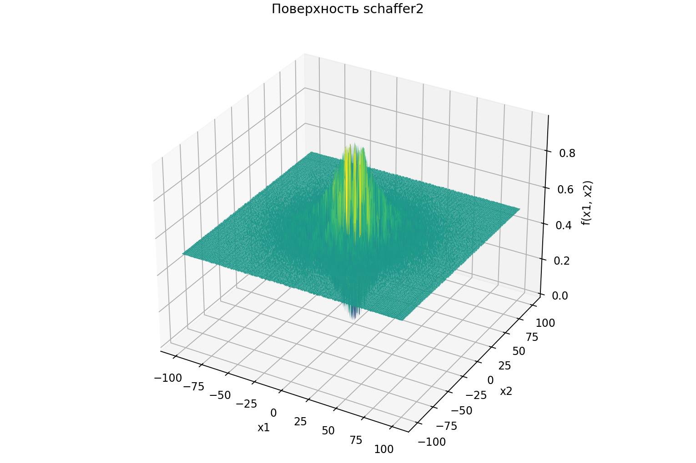
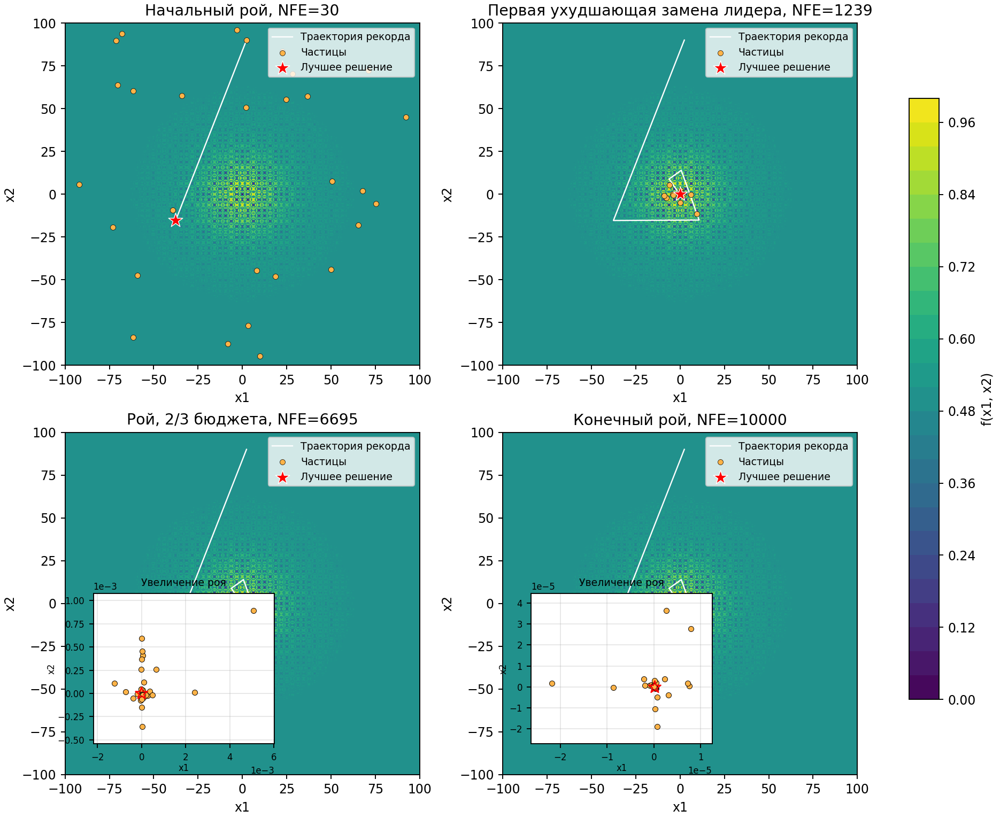
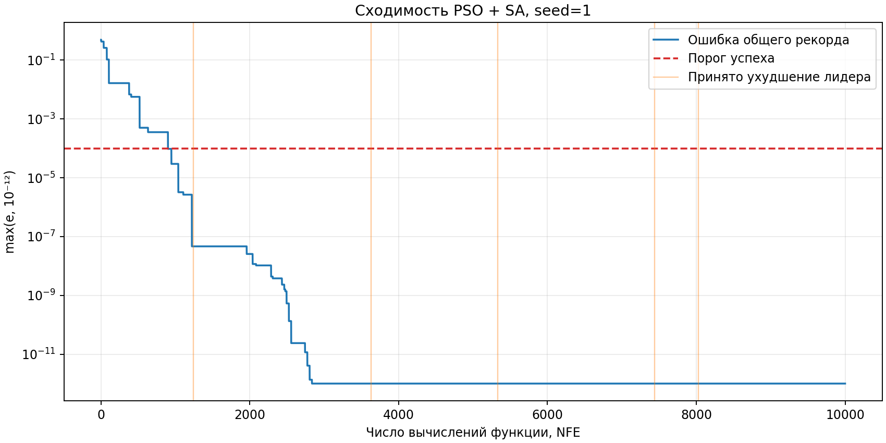
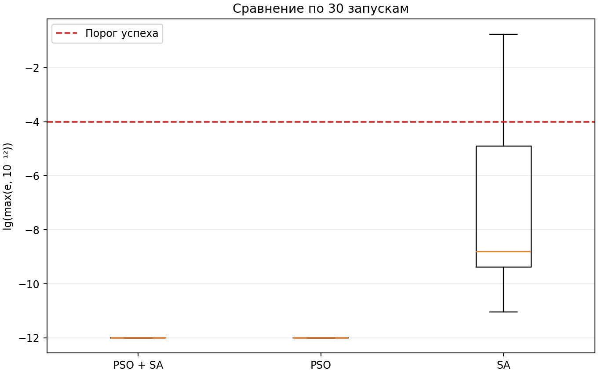

# Лабораторная работа № 5. Битва методов оптимизации

**Дисциплина** - Методы оптимизации  
**Выполнила** - Левчук Софья Александровна  
**Группа** - К3341  
**Поток** - МетОпт 1.2  
**Номер в списке потока** - 14  
**Преподаватели** - Духанов А.В., Лаврентьев С.М.  
**Вариант** - 14  
**Метод** - операторный гибрид PSO + SA

[Рефлексивный вывод](https://drive.google.com/file/d/1mcNmC70Ucj4PkIW1hdIdTijlAGVFeGdp/view?usp=drivesdk)

Самостоятельные задания и вопросы по методам выполнены в [EXERCISES.md](EXERCISES.md).

## 1. Постановка задачи и тестовая функция

Цель работы - реализовать гибридный метод глобальной минимизации функции двух переменных, исследовать его точность, надежность и время работы и сравнить с отдельными компонентами при одинаковом бюджете вычислений.

Для варианта 14 задан рой частиц PSO, в котором лидер заменяется по критерию Метрополиса из имитации отжига SA. Тестовая функция Шаффера N.2 имеет вид

$$
f(x_1,x_2)=0.5+\frac{\sin^2(x_1^2-x_2^2)-0.5}
{(1+0.001(x_1^2+x_2^2))^2}.
$$

Область поиска $D=[-100,100]^2$. Известный глобальный минимум $x^*=(0,0)$, $f^*=0$. Осциллирующий член создает множество локальных впадин, поэтому сосредоточение роя около одного лидера может привести к преждевременной сходимости.

Задача решается как поиск по черному ящику. Метод получает функцию и границы. Координаты и значение известного минимума используются в программе эксперимента для оценки результата.

Общий бюджет одного запуска равен 10000 вычислений функции. Нормированная ошибка и критерий успеха заданы формулами

$$e=\frac{f(x)-f^*}{\max(1,|f^*|)},\qquad e\le10^{-4}.$$

Для Шаффера N.2 ошибка равна найденному значению функции.



Поверхность и линии уровня рассчитаны на сетке 401 на 401 узел. Это дискретное изображение, которое передает общий рельеф, но не разрешает все мелкие колебания на большой области. Расчет сетки выполняется отдельно от поиска.

## 2. Идея комбинации

Я использовала операторную схему гибридизации, в которой PSO перемещает рой, а один шаг SA после обновления частиц изменяет его лидерский ориентир. Каждая частица сохраняет личный рекорд, а общий рекорд всего запуска хранится отдельно от текущего лидера. После движения частиц лидер заменяется найденной частицей, если ее значение лучше значения действующего лидера. Затем около лидера создается один гауссов кандидат, который принимается при улучшении или с вероятностью $\exp(-\Delta f/T)$ при ухудшении. Принятый кандидат становится ориентиром следующего движения всего роя. Поэтому лидер может временно уступать общему рекорду, что позволяет менять направление коллективного поиска. Температура и масштаб предложения геометрически уменьшаются по мере расходования бюджета, ослабляя возмущения к концу запуска. PSO выполняет основное исследование и сближение частиц, а SA регулирует разнообразие лидерских ориентиров и также может находить улучшения. Общий рекорд сохраняет лучшее найденное решение при любых ухудшающих заменах лидера.

Начальная температура определяется по разбросу значений функции в начальном рое

$$T_0=0.1\max\left(\max_i f(x_i)-\min_i f(x_i),\ \delta\right),$$

где $\delta=\varepsilon_{mach}\max(1,\max_i|f(x_i)|)$ защищает от нулевой температуры при одинаковых значениях. Для доли израсходованного после инициализации бюджета $p$ используются

$$T(p)=T_0(10^{-8})^p,$$
$$s(p)=0.05\left(\frac{10^{-5}}{0.05}\right)^p,$$
$$y=\operatorname{clip}\left(g+s(p)(b-a)\odot z,\ a,b\right),\qquad z\sim N(0,I).$$

Здесь $g$ обозначает текущего лидера, а $s$ задает стандартное отклонение шага как долю ширины каждой координаты. Проверка SA выполняется после полного движения роя при наличии оставшегося бюджета. Отдельных последовательных фаз PSO и SA в этой схеме нет. На графике сходимости отмечаются события принятия ухудшающего лидера.

## 3. Алгоритм

Скорость частицы обновляется по формуле

$$v_i\leftarrow wv_i+c_1r_1\odot(p_i-x_i)+c_2r_2\odot(g-x_i),\qquad x_i\leftarrow x_i+v_i.$$

Векторы $r_1,r_2$ содержат независимые равномерные числа из $[0,1)$. Скорость и положение обрабатываются по границам. Личные рекорды обновляются только при улучшениях.

```text
Проверить границы, бюджет и параметры
Создать генератор от seed
Создать и оценить начальный рой через Budget.eval
Сохранить личные рекорды, лидера и общий рекорд
Вычислить начальную температуру по разбросу значений

Пока остался бюджет
    Рассчитать скорости всех частиц по текущему лидеру
    Ограничить скорости и переместить частицы в допустимую область
    Оценить столько частиц, на сколько хватает бюджета
    Обновить личные рекорды и улучшить действующего лидера

    Если остался бюджет
        Вычислить температуру и масштаб шага по доле бюджета
        Создать одного соседа лидера
        Оценить кандидата через Budget.eval
        При улучшении принять кандидата
        При ухудшении принять его с вероятностью exp(-delta / T)
        Записать событие, если принят худший лидер

    При необходимости сохранить состояние роя

Вернуть общий рекорд, счетчик, историю и диагностику
```

Общий рекорд и история обновляются внутри `Budget.eval` при любом вызове функции, включая кандидатов SA. Принятый SA-кандидат меняет лидерский ориентир, а положения частиц и их личные рекорды продолжают обновляться по правилам PSO.

## 4. Параметры и распределение бюджета

| Параметр                         | Обозначение       | Имя в коде               | Значение               | Обоснование                                                            |
| -------------------------------- | ----------------- | ------------------------ | ---------------------- | ---------------------------------------------------------------------- |
| Размер роя                       | $N$               | `swarm_size`             | 30                     | Типичный размер из методички, позволяет выполнить более 300 обновлений |
| Инерция                          | $w$               | `inertia`                | 0.7                    | Устойчивая базовая настройка, исследованная в самостоятельной части    |
| Личный коэффициент               | $c_1$             | `cognitive`              | 1.5                    | Умеренное притяжение к личному рекорду                                 |
| Социальный коэффициент           | $c_2$             | `social`                 | 1.5                    | Согласованный с $c_1$ вклад лидера, устойчивый в исследованной серии   |
| Доля ограничения скорости        | $q_v$             | `velocity_fraction`      | 0.2                    | Задает $v_{max,j}=q_v(b_j-a_j)$ и ограничивает дальние перелеты        |
| Число предложений SA             | -                 | Одно предложение в цикле | 1 после обновления роя | Лидер меняется регулярно при небольшой доле затрат                     |
| Масштаб начальной температуры    | $k_T$             | `temperature_scale`      | 0.1                    | Задает $T_0$ по разбросу начальных значений                            |
| Конечная температура / начальная | $r_T=T_{end}/T_0$ | `temperature_ratio`      | $10^{-8}$              | Постепенно подавляет заметные ухудшения                                |
| Начальный относительный шаг SA   | $s_0$             | `step_start`             | 0.05                   | Допускает исследование окрестности лидера                              |
| Конечный относительный шаг SA    | $s_{end}$         | `step_end`               | $10^{-5}$              | Снижает пространственные возмущения к концу поиска                     |
| Бюджет                           | $NFE_{max}$       | `max_nfe`                | 10000                  | Единое ограничение из задания                                          |
| Зерно генератора                 | -                 | `seed`                   | 1...30 в эксперименте  | Воспроизводимость случайного поиска                                    |

Обозначения $N$, $q_v$, $k_T$, $r_T$, $s_0$ и $s_{end}$ введены здесь для сопоставления настроек с кодом. В формулах раздела 2 число 0.1 соответствует $k_T$, число $10^{-8}$ соответствует $r_T$, а начальное и конечное значения $s(p)$ равны $s_0$ и $s_{end}$. Индекс $j$ обозначает координату. Относительные шаги безразмерны, стандартное отклонение перемещения по координате равно $s(p)(b_j-a_j)$. Число предложений SA за цикл фиксировано алгоритмом. Генератор создается как `numpy.random.default_rng(seed)`.

На Шаффере начальный масштаб предложения SA равен 10 единицам по координате, конечный номинальный масштаб равен 0.002. Поскольку предложение выполняется только в определенные моменты, последнее предложение может предшествовать точному исчерпанию бюджета.

При стандартном бюджете и размере роя счетчик распределяется так

$$10000=30+321\cdot(30+1)+19.$$

Начальная популяция требует 30 вычислений. Затем выполняются 321 полное обновление из 30 частиц и 321 проверка SA, после чего остаются 19 вычислений для неполного обновления роя. Таким образом, PSO расходует 9679 вычислений, SA расходует 321, то есть 3.21% общего бюджета. Эти числа проверяются диагностикой каждого запуска. При другом бюджете последняя итерация также ограничивается оставшимся числом вычислений.

Параметры зафиксированы в `DEFAULTS` файла `optimizer.py`. Они являются выбранной базовой конфигурацией. Исчерпывающий подбор параметров гибрида не проводился.

## 5. Особенности реализации и условия применимости

Реализация находится в [optimizer.py](optimizer.py). Интерфейс соответствует заданию

```text
optimize(f, bounds, max_nfe=10_000, seed=None, constraints=None, **params)
```

Возвращается словарь с `x`, `f`, `nfe`, `history`, `switches`, `snapshots`, а также траекторией рекорда и диагностикой SA. Вариант 14 использует прямоугольные границы. `constraints=None` и пустой список допускаются, непустые дополнительные ограничения вызывают явную ошибку.

Все поисковые вычисления гибрида проходят через `Budget.eval`. Его структура основана на заготовке преподавателя и дополнена проверками, траекторией и диагностикой. Код гибрида не импортирует тестовые функции и не обращается к известному ответу. Используются собственные реализации методов, NumPy и стандартная библиотека Python. Matplotlib используется для визуализации снаружи поиска.

Скорость ограничивается по каждой координате. Вышедшая за прямоугольник точка проецируется на ближайшую границу, соответствующая скорость PSO обнуляется. Кандидаты SA также проецируются. Проекция может создавать скопление точек на границе и изменяет распределение предложений возле нее.

Остановка происходит при исчерпании бюджета. Известный порог точности не используется как внутренний критерий. Число выполненных вычислений, границы и возвращенное значение дополнительно проверяются снаружи метода в `run.py`. Контрольный пересчет найденной точки выполняется отдельно от поиска после остановки таймера.

Для выполнения шагов PSO нужны вещественные координаты и вычислимая функция. Для SA нужны способ создать соседа, вычисление функции и положительная температура.

Слабые места связаны с потерей разнообразия роя, слишком быстрым охлаждением, плато и масштабом функции. Шумные значения могут искажать личные рекорды. Область с очень узкой впадиной может потребовать других параметров. Добавление шага SA увеличивает накладные расходы, а на простой для PSO функции преимущество гибридизации может отсутствовать.

## 6. Эксперимент на функции Шаффера N.2

Один запуск выполняется командой `python run.py --func schaffer2 --seed 1`. Результат для `seed=1` из сохраненной основной серии:

```text
seed=1  x*=(2.03965324e-07, -1.76293154e-07)  f(x*)=0  NFE=10000  время=0.1432 с  успех
```

Координаты, значение функции, число вычислений и время взяты из [hybrid_schaffer2_runs.csv](results/hybrid_schaffer2_runs.csv).

Все три метода проверены по 30 раз с зернами от 1 до 30 и одинаковым бюджетом 10000. Перед измерениями выполнен прогрев каждого метода. Запуски последовательные, `OMP_NUM_THREADS=1`. Время измеряется через `perf_counter` с одинаковым внешним контролем для трех методов. Таблица относится к этой серии измерений. В самостоятельной части время получено другим запуском с более простой внешней проверкой, поэтому значения времени могут отличаться.

Эксперимент выполнен на компьютере с процессором Intel Core 5 220H, Windows. Использованы Python 3.10.11, NumPy 2.2.6 и Matplotlib 3.10.9. Наиболее долгий запуск основной серии занял менее 0.25 секунды при лимите 60 секунд.

| Метод    | Лучшее $f$            | Медиана $f$          | Худшее $f$            | Доля успехов | Среднее время, с | Среднее NFE |
| -------- | --------------------- | -------------------- | --------------------- | ------------ | ---------------- | ----------- |
| PSO + SA | 0                     | 0                    | $2.8866\cdot10^{-15}$ | 30/30 = 1.00 | 0.1548           | 10000       |
| PSO      | 0                     | 0                    | 0                     | 30/30 = 1.00 | 0.1147           | 10000       |
| SA       | $9.0015\cdot10^{-12}$ | $1.5293\cdot10^{-9}$ | 0.17363143            | 24/30 = 0.80 | 0.1747           | 10000       |

Нулевые значения относятся к арифметике `float64`. Из-за вычитания близких величин функция может округлиться до нуля в очень близкой к минимуму точке. Это не является доказательством точного совпадения координат.

### 6.1. Положение частиц и траектория



Показаны начальный рой, первая принятая ухудшающая замена лидера, состояние после примерно двух третей бюджета и конечное состояние при `seed=1`. Оранжевые точки обозначают частицы. Белая линия соединяет последовательные улучшения общего рекорда. Красная звезда показывает последний известный рекорд к моменту снимка. Эта линия отражает последовательность лучших решений всего поиска, поэтому ее точки могут принадлежать разным частицам или кандидатам SA.

Начальный рой распределен по всему квадрату. Далее частицы концентрируются около найденной области минимума. На полном масштабе близкие частицы перекрываются. Поэтому два нижних кадра дополнены увеличенными вставками с отдельными осями, которые охватывают весь рой и текущий общий рекорд. Во вставках показаны частицы и рекорд, цветной фон функции остается на основных кадрах. Множители возле осей задают порядок координат, например 1e-5 означает умножение подписей делений на $10^{-5}$. Масштабы вставок выбираются независимо для каждого снимка. При первом ухудшающем событии меняется лидер для следующего движения роя, а общий рекорд сохраняется.

### 6.2. Сходимость



На графике показана нормированная ошибка общего рекорда после каждого вычисления. Для этой функции она совпадает с $f-f^*$. Красная линия соответствует порогу $10^{-4}$. Для логарифмического отображения ошибки снизу ограничены числом $10^{-12}$. При `seed=1` порог впервые достигнут на 900-м вычислении. Позднее значение продолжает улучшаться и достигает нижней границы отображения.

Вертикальные линии отмечают принятые ухудшения лидера на вычислениях 1239, 3626, 5331, 7439 и 8028. Общий рекорд при этих заменах не ухудшается, поэтому синяя кривая остается невозрастающей. Нельзя по этому графику утверждать, что каждое улучшение вызвано предыдущей заменой лидера. Для строгой причинной оценки потребовался бы отдельный эксперимент с отключением оператора.

## 7. Сравнение гибрида с компонентами

Обычный PSO и самостоятельный SA реализованы в [components.py](components.py). Использованы те же настройки, что и в самостоятельной части. У PSO размер роя 30, $w=0.7$, $c_1=c_2=1.5$, скорость ограничена долей 0.2 ширины области. У отдельного SA температура изменяется от 0.5 до $10^{-6}$, масштаб шага от 0.1 до $10^{-5}$ ширины координаты. Отдельный SA выполняет 9999 переходов после начального вычисления. В гибриде его критерий встроен в выбор лидера и получает 321 предложение.



По вертикали отложено $\lg(\max(e,10^{-12}))$. Ниже означает меньшую ошибку. Линия внутри ящика показывает медиану, границы ящика соответствуют первому и третьему квартилям. На текущей серии результаты PSO и гибрида лежат ниже порога отображения и сжимаются в линии на уровне -12. У SA заметен разброс, часть запусков превышает порог успеха.

Гибрид и PSO достигли одинаковой доли успехов 1.00. По конечной ошибке и времени обычный PSO на данной функции предпочтительнее. Гибрид показал медианное число вычислений до первого успеха 791.5 против 823.5 у PSO. Для SA медиана по 24 успешным запускам равна 3084.5. Последнее число рассчитано только по успехам и не учитывает шесть неудач, поэтому требует совместного рассмотрения с долей успехов.

При одинаковых 10000 вычислениях среднее время гибрида составило 0.1548 с, а отдельного PSO - 0.1147 с. Число вычислений функции не учитывает всю работу программы. Гибрид дополнительно создает кандидатов SA, рассчитывает температуру и шаг, проверяет критерий Метрополиса. Кроме того, он сохраняет историю рекорда, траекторию, события и снимки роя, а внутри `Budget.eval` выполняет дополнительные проверки. Отдельный PSO такую подробную диагностику не ведет. Поскольку функция Шаффера вычисляется быстро, эти затраты заметны в общем времени. Поэтому разницу нельзя объяснить только 321 предложением SA. Для разделения затрат отжига и диагностики потребовалось бы отдельное измерение с одинаковым сбором данных.

Во всех 30 запусках гибрида были фактические ухудшающие замены лидера. В среднем принято 8.6 кандидата SA, из них около 8.23 ухудшающих; минимум по запускам составляет одну ухудшающую замену. Следовательно, оператор SA действительно менял ориентир частиц. Его влияние не сводится к объявлению второго компонента в названии.

На этой функции исследование не выявило общего преимущества гибрида перед PSO. По сравнению с отдельным SA гибрид повысил долю успехов с 0.80 до 1.00 и уменьшил среднее время в измеренной серии. Эти выводы относятся к конкретным настройкам, бюджету и набору зерен. Результат 30/30 не гарантирует успех на любых новых запусках.

### 7.1. Дополнительные функции

Проверена работа гибрида с теми же параметрами на трех дополнительных задачах, по 30 запусков на каждой. В `schaffer2~42` эталонная программа случайно сдвигает и поворачивает исходную функцию.

| Функция                         | Доля успехов | Медиана $f$          | Худшее $f$            | Среднее время, с |
| ------------------------------- | ------------ | -------------------- | --------------------- | ---------------- |
| Шаффера N.2, сдвиг и поворот 42 | 30/30        | 0                    | $3.7970\cdot10^{-14}$ | 0.1765           |
| Экли                            | 30/30        | 0                    | $3.5527\cdot10^{-15}$ | 0.2079           |
| Розенброка                      | 30/30        | $2.0393\cdot10^{-9}$ | $1.8136\cdot10^{-8}$  | 0.1500           |

Сдвинутая задача проверяет, что поиск не привязан к минимуму в начале координат. На дополнительных функциях проверен только гибрид, поэтому эти серии не устанавливают его преимущество перед компонентами. Отдельно проведена контрольная проверка квадратичной функции с минимумом на углу прямоугольника. Найдена граничная точка с нулевой ошибкой.

## 8. Запуск и состав файлов

Команды выполняются из папки `lab5`.

```bash
python -m pip install -r requirements.txt
python run.py --func schaffer2 --seed 1
python run.py --func schaffer2 --runs 30
python run.py --func schaffer2 --method pso --runs 30
python run.py --func schaffer2 --method sa --runs 30
python demo.py --func schaffer2 --runs 30
python run.py --func schaffer2~42 --runs 30
```

Из корня существующего проекта с локальным окружением можно запустить

```powershell
.\.venv\Scripts\python.exe lab5\run.py --func schaffer2 --seed 1
.\.venv\Scripts\python.exe lab5\demo.py --func schaffer2 --runs 30
```

`run.py` выводит координаты, значение функции, внешний счетчик, время и статус успеха. Для каждого запуска в терминале также печатается JSON с измерениями, названием функции и метода. Отдельный JSON-файл автоматически не создается. При `--runs` больше 1 измерения сохраняются в CSV и выводится строка Markdown-таблицы. При одиночном запуске результат остается в выводе терминала.

`demo.py` заново выполняет сравнение трех методов, сохраняет измерения и сводную таблицу в CSV и создает четыре рисунка. Повторные запуски перезаписывают соответствующие измерения и рисунки, время в отчете относится к приведенной серии.

| Файл                                 | Назначение                                        |
| ------------------------------------ | ------------------------------------------------- |
| [optimizer.py](optimizer.py)         | Гибрид, бюджет и данные для визуализации          |
| [components.py](components.py)       | Отдельные PSO и SA, общая проверка входных данных |
| [functions.py](functions.py)         | Эталонные функции из комплекта преподавателя      |
| [run.py](run.py)                     | Запуск, внешние проверки, время, JSON и CSV       |
| [demo.py](demo.py)                   | Сравнение методов и четыре рисунка                |
| [study.py](study.py)                 | Эксперименты самостоятельной части                |
| [requirements.txt](requirements.txt) | NumPy и Matplotlib                                |
| [EXERCISES.md](EXERCISES.md)         | Самостоятельная работа                            |
| `results/`                           | Измерения каждого запуска и сводные таблицы       |
| `img/`                               | Рисунки самостоятельной и основной частей         |

Измерения основного эксперимента и дополнительных проверок сохранены в следующих файлах. Каждый файл отдельных запусков содержит 30 строк данных с зернами от 1 до 30 и бюджетом 10000 на запуск.

**Основные файлы результатов:** `comparison_schaffer2.csv` и три подробные серии `hybrid_schaffer2_runs.csv`, `pso_schaffer2_runs.csv`, `sa_schaffer2_runs.csv`. Сводная таблица содержит итоговое сравнение методов, а подробные серии позволяют проверить отдельные запуски и пересчитать показатели разделов 6 и 7.

Остальные CSV сохранены как дополнительные исходные данные экспериментов. Серии на сдвинутой Шаффере, Экли и Розенброке подтверждают проверки из раздела 7.1. Файлы самостоятельной части сохраняют ее отдельные эксперименты и исследование чувствительности. Они полезны для повторной проверки расчетов и уточнения результатов. Сам поиск запускается по коду, результаты каждого нового эксперимента создаются заново.

| Файл в `results/`                                                                    | Метод          | Функция                            | Назначение                                               |
| ------------------------------------------------------------------------------------ | -------------- | ---------------------------------- | -------------------------------------------------------- |
| [hybrid_schaffer2_runs.csv](results/hybrid_schaffer2_runs.csv)                       | PSO + SA       | Шаффера N.2                        | Основная серия гибрида, раздел 6                         |
| [pso_schaffer2_runs.csv](results/pso_schaffer2_runs.csv)                             | PSO            | Шаффера N.2                        | Сравнение с отдельным роем, раздел 7                     |
| [sa_schaffer2_runs.csv](results/sa_schaffer2_runs.csv)                               | SA             | Шаффера N.2                        | Сравнение с отдельным отжигом, раздел 7                  |
| [comparison_schaffer2.csv](results/comparison_schaffer2.csv)                         | Все три метода | Шаффера N.2                        | Три строки сводных показателей по основным сериям        |
| [hybrid_schaffer2~42_runs.csv](results/hybrid_schaffer2~42_runs.csv) | PSO + SA       | Сдвинутая и повернутая Шаффера N.2 | Проверка независимости от положения минимума, раздел 7.1 |
| [hybrid_ackley_runs.csv](results/hybrid_ackley_runs.csv)                             | PSO + SA       | Экли                               | Дополнительная многоэкстремальная функция, раздел 7.1    |
| [hybrid_rosenbrock_runs.csv](results/hybrid_rosenbrock_runs.csv)                     | PSO + SA       | Розенброка                         | Проверка поиска в узкой изогнутой долине, раздел 7.1     |

Число 42 в имени `schaffer2~42` задает преобразование функции, ее сдвиг и поворот. Зерна самих запусков поиска по-прежнему меняются от 1 до 30.

В файлах отдельных запусков столбцы `seed`, `x1`, `x2`, `f`, `error`, `nfe`, `time_s` и `success` содержат зерно, найденные координаты, значение функции, нормированную ошибку, число вычислений, время и признак успеха. Столбец `first_success_nfe` показывает число вычислений до первого достижения порога, 0 означает отсутствие успеха. Поля `sa_attempts`, `sa_accepted`, `sa_uphill`, `pso_nfe` и `sa_nfe` содержат диагностику гибрида. У отдельных компонентов эти диагностические поля заполнены нулями, фактические затраты находятся в `nfe`.

Файлы `pso_runs.csv`, `sa_runs.csv`, `components_summary.csv`, `sensitivity.csv` и `sensitivity_runs.csv` относятся к самостоятельной части и описаны в [EXERCISES.md](EXERCISES.md). Основное сравнение использует новые серии с одинаковым внешним контролем всех трех методов.

Эталонный `functions.py` включен в исходном виде. Для переноса решения нужно сохранять вместе `optimizer.py` и `components.py`, поскольку гибрид использует общую проверку данных.

Проверены бюджеты 1, 2, 29, 30, 31, 32, 60 и 101, точный внешний счетчик, допустимость точек, невозрастание истории, воспроизводимость при одинаковом зерне, согласованность найденной точки и значения, ошибки некорректных параметров и полноценные серии по 30 запусков.

## 9. Источники

1. [Задание лабораторной работы № 5, материалы преподавателя](https://drive.google.com/file/d/1cBqh4XWKK-ExP7pEb3Tr_Y1CUSUYpfis/view).
2. [Указания по методам, материалы преподавателя](https://drive.google.com/file/d/1QV6fK9FiCaRnSnbPzEZe0RI-D-Y1Ode3/view). Использованы формулы PSO, критерий Метрополиса и рекомендации по исследованию.
3. [Стартовый комплект преподавателя](https://drive.google.com/drive/folders/1DodQKhS5DLBZeB5Z0urEnoFVdNepvC3x). Использованы интерфейс, организация учета вычислений и эталонный набор функций.
